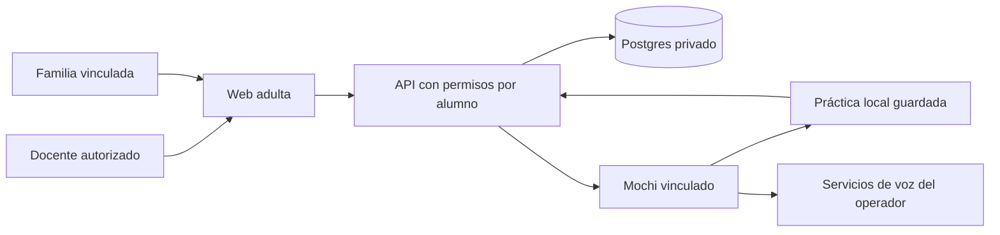

# Guía del monorepo

## Flujo educativo

El docente crea clases y alumnos, asigna actividades, revisa evidencias y
publica observaciones. Introduce las calificaciones manualmente. La familia
consulta sólo a sus estudiantes vinculados y controla horarios, recordatorios,
voz, alternativa textual y datos opcionales.

La placa presenta un jardín con casitas y actividades de cestas/manzanas,
estanques/peces y cajas/coches. Las cantidades dependen del ejercicio descargado.
Los objetos se dibujan completos hasta 48; para cantidades superiores se usan
rótulos numéricos. Las pistas y los descansos conservan el avance. Las preguntas
descargadas no necesitan un navegador infantil ni una conexión permanente.

La voz usa el micrófono sólo mediante la interacción prevista del dispositivo.
ASR, tutor y TTS se ejecutan en servicios conectados. Los captions completos y
la prioridad de texto permiten seguir la tarea sin depender del sonido. Las
preferencias y su aplicación física deben comprobarse con el firmware instalado.

## Colaboración

En **Grupos y ayuda**, el docente organiza equipos de dos a ocho estudiantes de
la misma clase. La participación es voluntaria. Acompañar es un papel de la
actividad, no una etiqueta de capacidad. Cada integrante recibe su práctica.

Una revisión humana compartida registra 10 puntos. Cuando todas las prácticas
del lote tienen revisión compartida, se añaden 20 extra por integrante: 30 en
total. Una ayuda voluntaria, supervisada y confirmada por el docente añade 5 a
quien acompaña: hasta 35 para esa combinación. El servidor evita premios
duplicados por la misma acción. No se cambia la nota ni se publica un ranking.

## Acompañamiento familiar

La opción está desactivada por defecto y sólo la familia puede activarla. Una
señal de posible dificultad entre compañeros exige también la confirmación del
menor. Los destinatarios se fijan al compartirla: un familiar vinculado después
no hereda avisos históricos. Cada adulto revisa su copia y la retención prevista
es de 90 días. Los avisos no forman parte del perfil de aprendizaje, las
propuestas de actividad ni los puntos.

El panel muestra estudiante, fecha y estado, sin audio ni transcripción del
aviso. Una señal no confirma lo ocurrido. Escuchar con calma, sin culpar, y
buscar un adulto de confianza son orientaciones para iniciar el acompañamiento.
Fuente: [UNICEF, recomendaciones para familias](https://www.unicef.org/egypt/bullying/tips-parents-bullied).

## Modos y datos

Los modos personal y educativo tienen identidades, permisos y memoria separados.
Este export no contiene conversaciones, referencias de voz, credenciales ni
datos de alumnos. Las herramientas históricas de NAS o placa requieren
configuración privada y algunas conservan supuestos del equipo original.
Consulta `SECRET_SCAN.json` para las referencias de rutas detectadas.

No ejecutes diagnósticos que cambian una tarea, la radio o un vínculo sobre una
actividad real. Los tests de demostración deben usar cuentas y alumnos ficticios.
